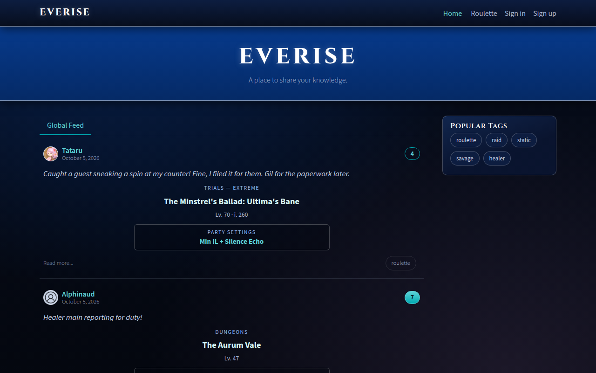
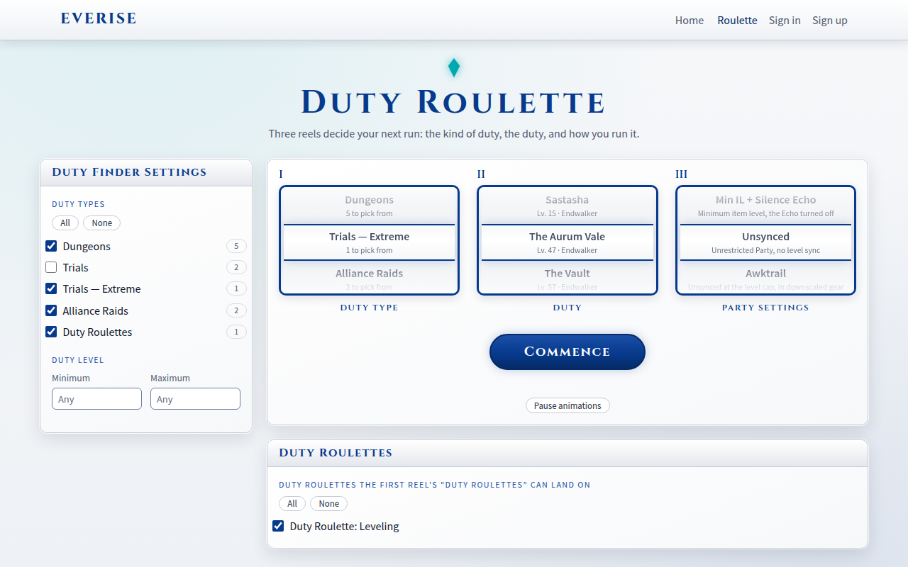
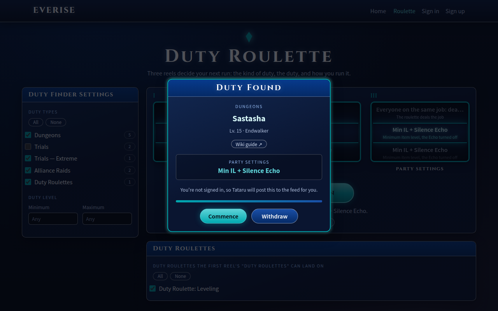

<div align="center">

# ✦ Everise ✦

**The Everise FC community site, themed after Final Fantasy XIV: the free company's feed and Discord news, the Party Finder, community events and venues, a Duty Roulette, market price history and a chat with the game's characters.**

[](https://github.com/denis-coccodi/everise-frontend/actions/workflows/ci-cd.yaml)


[**everise.dev**](https://everise.dev) · [Backend](https://github.com/denis-coccodi/everise-backend) · [Documentation](https://everise.dev/docs/frontend/) · [Site guide](https://everise.dev/guide/)



| Duty Roulette (light mode)                                                                                                                   | "Duty Found"                                                                                            |
| -------------------------------------------------------------------------------------------------------------------------------------------- | ------------------------------------------------------------------------------------------------------- |
|  |  |

</div>

## Tech stack

| Part      | Choice                                                                                                                                       |
| --------- | -------------------------------------------------------------------------------------------------------------------------------------------- |
| Framework | [Angular 22](https://angular.dev): standalone components, signals, zoneless change detection, signal forms                                   |
| Workspace | [Nx 23](https://nx.dev) monorepo: one app, libraries by domain and layer                                                                     |
| State     | [NgRx Signal Store](https://ngrx.io/guide/signals), and resources for loads a page shows                                                     |
| API types | Generated from the backend's OpenAPI document with [openapi-typescript](https://openapi-ts.dev); CI fails on drift                           |
| Language  | [TypeScript 6](https://www.typescriptlang.org/), strict templates, no `any` outside specs                                                    |
| Tests     | [Vitest](https://vitest.dev) unit tests in every project; `scripts/smoke.sh` against each deploy                                             |
| Hosting   | [Cloudflare Workers](https://developers.cloudflare.com/workers/) static assets, `/api` forwarded to the backend Worker; no service worker    |
| Backend   | [everise-backend](https://github.com/denis-coccodi/everise-backend): Express 5 and zod on Cloudflare Workers, SQLite in a Durable Object, R2 |

## Getting started

With Node.js 22 and the [backend](https://github.com/denis-coccodi/everise-backend) running next to this repository
(`npx wrangler dev --port 8080` there):

```sh
npm install                # also sets up the git hooks (format check, commit message)
npm start                  # http://localhost:4200, calling the local backend
npm run orchestrator       # Claude Code's orchestrator, with the backend in scope
```

Before pushing, the checks in `CLAUDE.md` (the same as the required `test` check) must pass. Every command is in
[Development](https://everise.dev/docs/frontend/development.html).

## Where things are

- **[Documentation](https://everise.dev/docs/frontend/)** (`docs/`): architecture, the theme, accessibility, the
  website's structure, development, deployment and each feature; the plain-language [site guide](https://everise.dev/guide/)
  is in `docs/_guide`.
- **[Skills](.claude/skills)** and **[agents](.claude/agents)**: how work is done here, for people and Claude alike;
  shared ones come from the [everise plugin](https://github.com/denis-coccodi/everise-agents). Start with `CLAUDE.md`.

Game data and images come from the backend, which caches them from [XIVAPI](https://v2.xivapi.com). FINAL FANTASY XIV
© SQUARE ENIX CO., LTD. Game images are used under Square Enix's fan site materials licence.
