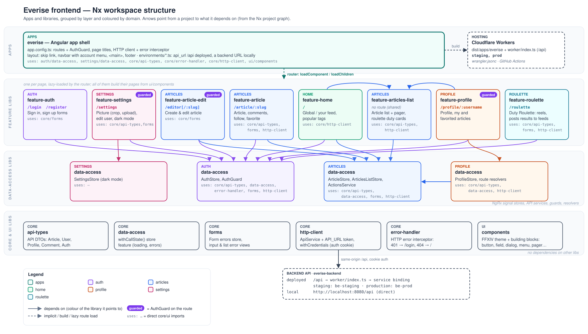

# Architecture

## Stack

| Part      | Choice                                                                                          |
| --------- | ----------------------------------------------------------------------------------------------- |
| Framework | Angular 22: standalone components, signals, zoneless change detection, control flow blocks      |
| Workspace | Nx 23 monorepo: one app, libraries by domain and layer                                          |
| State     | NgRx Signal Store                                                                               |
| API types | Generated from the backend's OpenAPI document with openapi-typescript; a CI job fails on drift  |
| Language  | TypeScript 6, strict templates, no `any` outside specs                                          |
| Tests     | Vitest in every project; `scripts/smoke.sh` against each deploy                                 |
| Hosting   | Cloudflare Workers static assets, `/api` forwarded to the backend Worker over a service binding |

## Libraries

`apps/everise` is a thin shell: routes, guard, page titles, HTTP setup and layout. Everything else lives in `libs/`, grouped by domain: `articles`, `auth`, `events`, `home`, `market`, `media`, `notifications`, `party-finder`, `planner`, `profile`, `relays`, `roulette`, `settings`, `venues`, `waking-sands`, plus `core` and `ui`.

Each domain is split into layers:

- **feature:** a page or a few related pages, lazy-loaded by the router.
- **widget:** feature pieces several pages show, so no page imports another. Examples:
  - the feed list (`articles/feature-articles-list`);
  - the Weekly and Hunts tabs (`relays/feature-relays`);
  - the event card (`events/feature-event-card`);
  - the Party Finder listing card (`party-finder/feature-pf-listing`);
  - post media (`media/feature-media`).
- **data-access:** NgRx signal stores, API services, guards and resolvers. A load whose loading or error a page shows is an Angular resource, read directly (`hasValue()`, `isLoading()`, `error()`).
- **core and ui:**
  - API types, the HTTP client (with `LiveUpdates`, the live-updates WebSocket), form errors and error handling;
  - the theme and the themed building blocks.
    They depend on no other libraries.

Dependencies only point down a layer: never up, and never from one page to another. `@nx/enforce-module-boundaries` fails an import that breaks this in lint. Run `npx nx graph` to see the live project graph.

## API types

- **Generated, not written:** the shapes the app sends and receives are generated, never written by hand. The backend commits its OpenAPI 3.1 document, and `npm run api-types` turns it into `libs/core/api-types/src/lib/generated/openapi.ts`.
- **Named exports:** the library names the schemas, e.g. `export type Article = Schemas['Article']`.
- **Drift check:** a CI job fails when the generated types drift from the backend's document.

## Code rules

The full rules are in the repository's skills (`.claude/skills`): `frontend-best-practices`, `theme`, `mobile-first`, `accessibility`. In short:

- **Libraries by type, enforced by lint.** What two pages share becomes a widget, a data-access library or a UI building block.
- **Folders:**
  - one component per folder, named after it, pages included;
  - stores and API services live only in data-access libraries;
  - folders are named after what they hold, never `components/` or `services/`.
- **Imports:** libraries are imported only by their `@everise/…` entry point.
- **Components:**
  - state in NgRx signal stores, and components use signals and `OnPush`;
  - a load whose status a page shows is a resource; other calls are `rxMethod`;
  - forms are signal forms only.
- **No `any`** outside specs, and no `$any()` in templates.
- **Errors** are shown with the backend's own message (`serverMessage()`) in the shared message component.
- **Size limits** (`scripts/check-sizes.mjs`): component classes 200 lines, templates 150, styles 250, stores and services 250, other TypeScript 350. A file that grows past a limit is split, never exempted.
- **Specs** sit next to the code in every project, with a shared setup (`@everise/core/testing`).

## Feature flags

Each environment file has `features`, one `true`/`false` per feature still being built: `true` locally and on staging, `false` in `environment.prod.ts` until it's released. Only the app shell reads them, to leave out the feature's routes and nav links. Today the only flag is `planner`.
