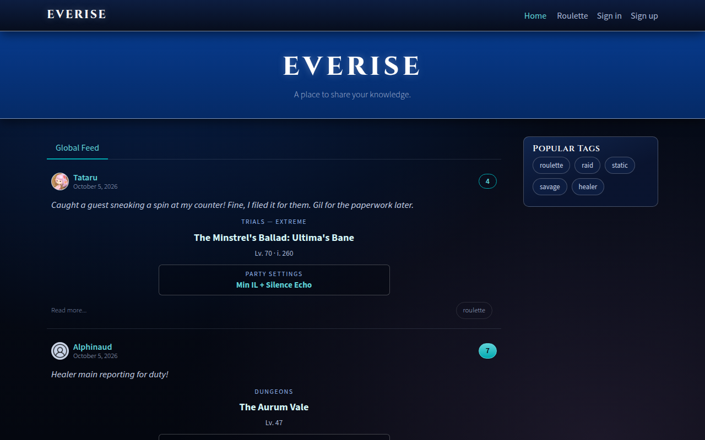

# Everise frontend

The Angular app of [everise.dev](https://everise.dev), the Everise FC community site, themed after FINAL FANTASY XIV. It talks to the [backend](/docs/backend/) through `/api`, which the frontend Worker forwards over a service binding.

These pages are the frontend's technical reference. They live in the repository's `docs/` folder, change in the same pull requests as the code, and are served at everise.dev/docs/frontend/. The plain-language [site guide](/guide/) is built from the same folder (`docs/_guide`), and the [backend docs](/docs/backend/) from the backend's.

| Page                                      | What it covers                                                  |
| ----------------------------------------- | --------------------------------------------------------------- |
| [Architecture](architecture.md)           | Nx layers, libraries, state, API types, code rules              |
| [Website structure](website-structure.md) | Every page, its address and who can use it                      |
| [Theme](theme.md)                         | The FFXIV look, role tokens, building blocks, where styles live |
| [Accessibility](accessibility.md)         | WCAG 2.2 AA rules and how to check a change                     |
| [Development](development.md)             | Running locally, commands, the checks before pushing            |
| [Deployment](deployment.md)               | The Worker, environments, CI/CD, releases, search engines       |
| [Fight planner](fight-planner.md)         | How the planner plans a pull in the browser                     |

