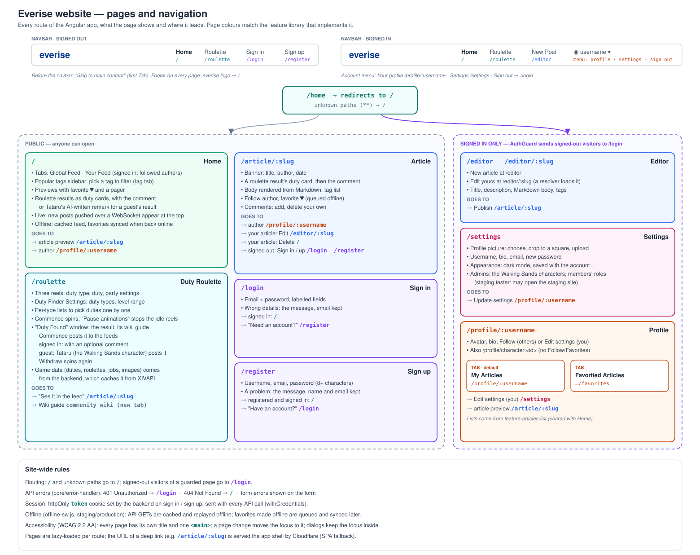

# Website structure

The diagram is generated from the routes (`app.routes.ts` and each feature's `<feature>.routes.ts`) and the navbar's groups (`nav-groups.ts`). Regenerate it with `node tools/diagrams/website-structure.js docs/website-structure.svg`. A new route needs a card in that script's `SECTIONS`, or it refuses to generate.

## Navigation

The navbar shows **Home**, then two groups:

- **Community:** Party Finder, Venues, Events, The Waking Sands.
- **Tools:** Duty Roulette, Market History, and Fight Planner (only where the `planner` flag is on).

## Pages

| Page                                  | Address                                                                        | Library                                                                            | Guests                                               | Members                            |
| ------------------------------------- | ------------------------------------------------------------------------------ | ---------------------------------------------------------------------------------- | ---------------------------------------------------- | ---------------------------------- |
| Weekly / Hunts                        | `/`, `/?view=hunts`                                                            | `relays/feature-relays`                                                            | read                                                 | read                               |
| Global Feed / Your Feed               | `/?view=global`, `/?view=yours`                                                | `home/feature-home`, `articles/feature-articles-list`                              | read the global feed                                 | post, comment, favourite, follow   |
| Post                                  | `/article/<id>`                                                                | `articles/feature-article`                                                         | read                                                 | comment, share to Discord          |
| Editor                                | `/editor`                                                                      | `articles/feature-article-edit`                                                    | —                                                    | write and edit posts               |
| Party Finder                          | `/party-finder`                                                                | `party-finder/feature-party-finder`                                                | browse                                               | share as post or to Discord        |
| Events                                | `/events`, `/events/<id>`                                                      | `events/feature-events`                                                            | browse                                               | share to Discord                   |
| Venues                                | `/venues`, `/venues/<id>`                                                      | `venues/feature-venues`                                                            | browse                                               | share to Discord                   |
| The Waking Sands                      | `/waking-sands`                                                                | `waking-sands/feature-waking-sands`                                                | watch                                                | talk with the characters           |
| Duty Roulette                         | `/roulette`                                                                    | `roulette/feature-roulette`                                                        | spin; Tataru posts the result                        | spin and post with a comment       |
| Market History                        | `/market-history`                                                              | `market/feature-market`                                                            | what it does, and a sign-up                          | full charts                        |
| Fight Planner                         | `/planner`                                                                     | `planner/feature-planner`                                                          | plan, within 10 new reports and 10 new pulls an hour | plan                               |
| Profile                               | `/profile/<id>`, `/profile/<id>/favorites`                                     | `profile/feature-profile`                                                          | read                                                 | follow                             |
| Settings                              | `/settings`                                                                    | `settings/feature-settings`                                                        | —                                                    | account, appearance, admin windows |
| Sign in, sign up and account recovery | `/login`, `/register`, `/confirm-email`, `/forgot-password`, `/reset-password` | `auth/feature-auth`                                                                | —                                                    | —                                  |
| Privacy policy                        | `/privacy`                                                                     | `auth/feature-auth`                                                                | read                                                 | read                               |
| Site guide, developer docs            | `/guide/`, `/docs/frontend/`, `/docs/backend/`                                 | served by the Worker from GitHub Pages ([Deployment](deployment.md#documentation)) | read                                                 | read                               |

## Pages whose state is in the address

Several pages keep everything they show in the query string, so any view can be linked, bookmarked, or reached again with Back:

- **Party Finder:** `?dc=light&world=odin&category=…&slot=healer&search=…&sort=ending-soon&no-duty=show&beginners=only&page=2`. It opens on Light with all its worlds.
- **Duty Roulette:** `?types=1,3,6&min=50…`, only where the settings differ from the defaults.
- **Market History:** the item, region, quality, days and worlds.
- **Events and Venues:** `?dc=` and `?search=`.
